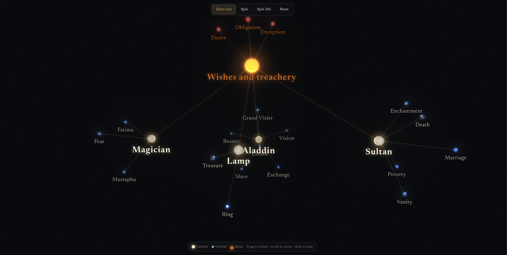
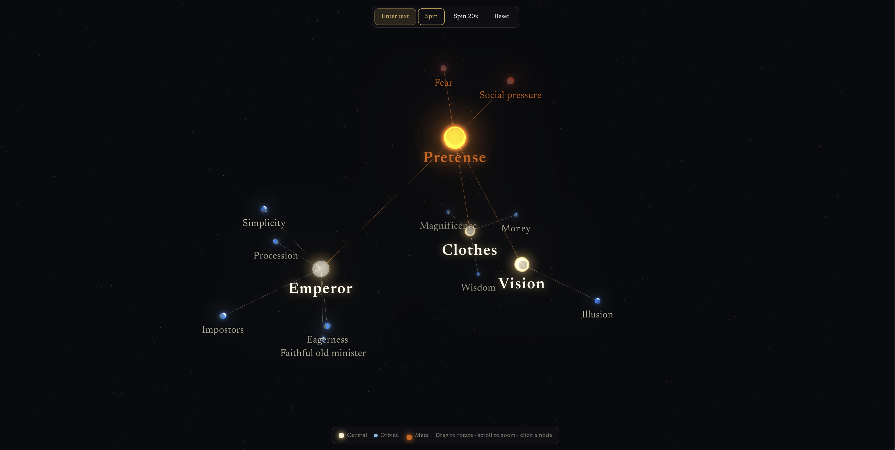
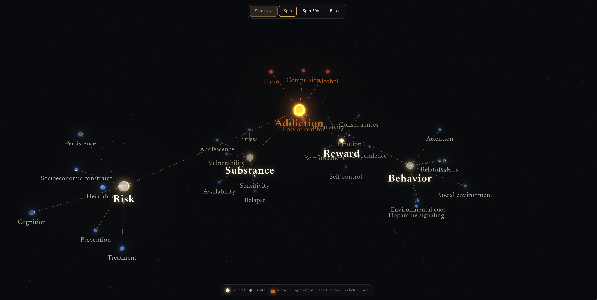
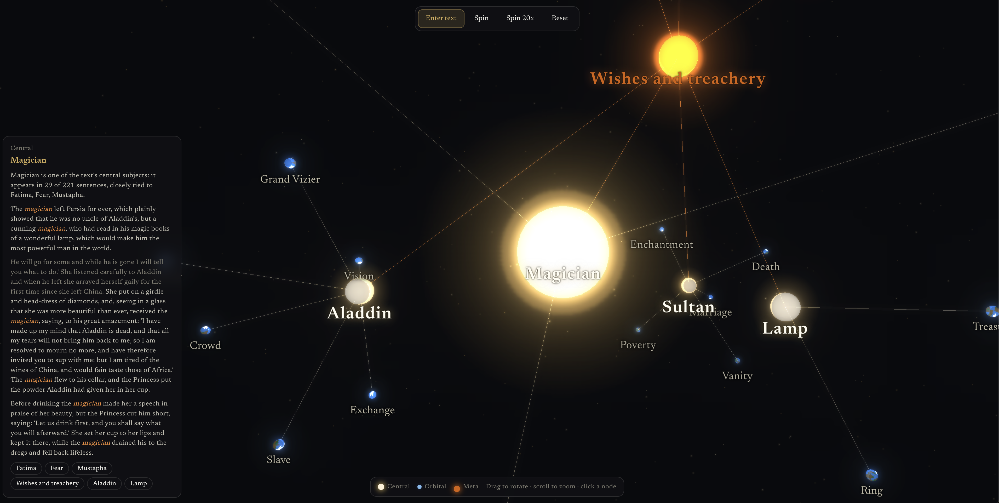
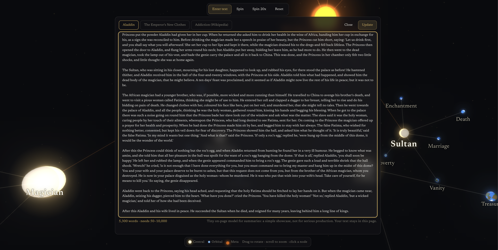

# 3D Mindmap Summaries

This is a showcase project.

The core idea of this mini project:
Design a webpage,
that allows the user to enter any text of their choice,
and be presented with a concise interactive 3D network summary of the text.

It exists to make the structure of a piece of writing visible at a glance, and to explore how far a transparent, rule-based model can go before a large language model is needed. Everything runs in the browser, any tested input text never leaves the page.

| | |
| :---: | :---: |
|  |  |
|  |  |

## Design Decisions

**UX/UI**:

- **Clean and minimalistic Visualisations** overall
  - Dark-themed minimalism
    - exceptions to minimalistic choices: skins of nodes resembling earth-like planets, card texts featuring complete sentences
  - *Font*: only one font, only a few intentionally different font sizes, only one default primary font color and a secondary highlighted color of text
    - an elegant, horizontally compact serif font will be selected and featured everywhere in white
    - emphasized words will be colored in the same yellow to orange color everywhere
- **Button design**:
  - white fonts, yellow highlights as before using the same font
  - concise button name choices
  - restriction to an intuitive minimalist functionality
- **Scene design**:
  - It should resemble a star-like constellation in space
  - It can differentiate between Central, Orbital, and Meta nodes
  - Strong hierarchical restriction of the network to keep complexity low:
    - Not everything can be connected: Orbitals are only connected to their associated Central (or Meta) node
    - Other than that Central Nodes are only linked to the Meta node
  - Nodes should resemble stars, planets, or similar object but otherwise not distract from the minimalist design; playful exceptions:
    - Nodes can have skins (the surface of Orbitals is designed earth-like with a random generator of land and forest masses)
    - Nodes can have an aurora: yellow for Central nodes, orange for Meta nodes, red for Meta orbitals, Dark blue for normal orbitals
- **Information content**:
  - The input text should be editable and visible but usually collapse towards a button near the top
  - The input text will be limited in minimum and maximum word count to a reasonable text length
  - The nodes in the featured 3D space should have concise names
    - Preferable are nominalisations or nouns when the text features verbs or adjectively heavily; e.g. "Vision" instead of "see"
  - These nodes should be structured hierarchical with 3 different levels as mentioned above:
    - Central, Orbitals; Meta
    - Central and Orbital nodes feature core words and commonly associated words respectively
    - The Meta node aims to find a *core theme* or *concept* or *ethical perspective* that underpins the whole text
      - In case of doubt "?" is allowed for the Meta node; the Meta node can feature Orbital nodes as well
    - The number of Central nodes should be restricted to 4 or less and roughly scale with the length of the input text
    - Any specific node should list core occurrences or contain associated information
- **User interaction**:
  - The user should be able to zoom and rotate the scene
    - Input text and card text are intended to be collapsed when navigating the 3D scene to keep distractions off
      - The input text will take roughly 2 thirds of horizontal and almost all vertical space as a central overlay
      - It should predominantly feature a *Close* and *Update* button and not much more
    - Only 3 options regarding automated rotation or "spin" of the scene will be provided:
      - None
      - Spin (default slow side spin of the constellation)
      - 20x Spin: 20x faster spin allows the user to see further away Central nodes reasonably fast without appearing hasty
    - There is a "Reset" option: Restore default camera angle, view, spin for the current text
    - Rotation, Reset, and Text field options are featured in a minimalistic way horizontally centered near the top of the screen
    - Clicking on nodes should yield more information about word occurrences
      - It will open a card to the lower left side of the screen
      - It will not feature a *Close* button but instead collapse after the user clicks anywhere in the space
        - Explanation of this deliberate UXUI inconsistency: The behavior is intuitive enough to explore for users within seconds, and easier to achieve since the card only occupies a small portion of the whole page compared to the input text field
        - It will move the camera in a slow and deliberate motion towards the selected node and shortly behind it in a way that keeps the node central to slightly to the right of the center (since the left-sided card text takes away space from the screen); additionally the camera will rotate back facing the invisible "center of mass" of the overall node constellation, to uphold a better 3D orientation for the user and allow an easier subsequent navigation (otherwise we would just see a node and empty space: without rotation or Reset there is no easy way to navigate back in that case)
        - Word or associated word occurrences will be highlighted in the secondary color (orange)
    - **Camera**: Camera zoom speed, camera rotation settings: will be fine-tuned with many iterations and tested for the 3 sample texts

**Text Summary**:

- As a proof of concept the text summary can initially work without a strong LLM model (AI) underneath to avoid any hosting costs
  - Connecting this with a local or cloud-hosted model will produce significantly better summaries
    - No LLM being involved provides a hard challenge to arrive at a meaningful selection of key terms and associated summary based on the text
  - Instead a logic should be designed that contains a small dictionary of about 200-300 entries
    - entries from topics surrounding
      - morals
      - health
      - psychology, and
      - (business) strategy;
    - otherwise: the text model should work with word counts and a specific set of rules (compare below)
    - three sample texts should be included and easily selectable when opening the text field

## How the model works

The analysis lives in `assets/text_model.js` and is deliberately simple.
It is not a neural network and not a large language model.
There is no learned weight anywhere in it.

It splits the text into sentences and words, drops common function words, and finds candidate terms in three ways:

- capitalised phrases (treated as names, events or places),
- dates and years, and
- recurring two-word phrases.

Each candidate is scored by how often it appears, how central it is in a co-occurrence graph, and a few heuristics such as penalising verbs and family-role words. The highest-scoring terms become Central ideas, and the terms that co-occur with them become Orbital ideas. The Meta node is chosen by matching the text against a hand-written lexicon of about 200 ideas around moral wisdom, strategy rules of thumb, and everyday or domain-specific messages. Each idea has a list of strong and weak keywords, matched by stem of the word. The idea with the strongest evidence wins, or the node shows "?" when nothing matches clearly. A sentence that explicitly states a moral (such as "Moral: ...") or a takeaway ("we learned that...") is used directly when present.

In short: the model "understands" a text only in the sense of counting, ranking and keyword matching: it can tell which words recur and which ideas the author's vocabulary points to, but it cannot infer unstated morals, really look beyond, or notice irony. That is why --despite efforts to manually tune the lexicon in several iterations-- its Meta labels are sometimes plausible and sometimes off.

## Ways to improve it

The most direct improvement is to replace the Meta lexicon with a real language model. A large model, either hosted behind an API or run locally, could be prompted with a fixed schema (central ideas, orbital ideas, and one meta idea phrased as a short principle, with an explicit "unclear" option), returning a JSON structure that the viewer already understands. A mid-sized open model fine-tuned on a few thousand human-written summaries of fables, articles and self-help texts would produce more natural meta phrasing. Embeddings offer a middle path: the lexicon stays, but matching becomes semantic rather than keyword-based, so "reluctant to speak up" would match "fear of speaking up" effortlessly. Any of these would need an evaluation set of texts with human ratings, so that changes can be compared objectively instead of by eye. Other natural extensions:

- *multilingual lexicons*: currently only English is supported (and German to a lesser degree)
- *user-editable or memory options*: editable lexicons or remembering of input texts or editable nodes or card texts
- *export options*: an export of the network as data for further analysis elswhere.

## Files

- `network_example.html`: the built page; open it directly in a browser
- `generate_network.py`: builds the page from the template, assets and sample text (`python generate_network.py`, with `--inline` for offline use)
- `network_template.html`: markup, styles and placeholders
- `assets/text_model.js`: the text analysis and the Meta lexicon
- `assets/viewer.js`: the three.js scene, physics, camera and controls
- `sample_text.txt`: sample text, cached: "The Emperor's New Clothes"
- `sample_text_addiction.txt`: sample text, cached: "Addiction (Wikipedia)"
- `sample_text_aladdin.txt`: sample text, cached: "Aladdin and the Wonderful Lamp"
